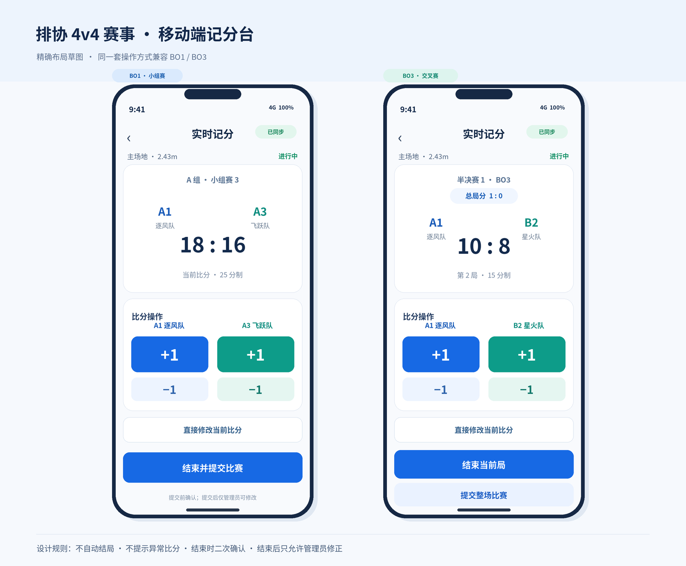

# 排协4v4赛事网站 V1.0 产品与交互设计

本文件是开发 Agent 可直接阅读的主要需求参考。下方“原始 V1.0 设计正文”由同目录 Word 原件完整转换，保留原有章节、表格和固定赛程；Word 原件继续保留，不随本次转换修改。

需求优先级：**用户最新明确指令 > 已确认产品需求及后续决策 > UI 原型**。后续确认事项优先于原始正文中的早期表述。历史 Review 记录仅用于追溯，不覆盖后续决定，也不授予新阶段开发权限。

## 后续已确认的决定

- **工作人员密码（2026-10-16）**：管理员保留当前配置的密码，网页不再提供随机重置或修改管理员密码的入口。管理员可直接设置主、副场地记分员密码，修改后对应记分员的旧密码和旧会话失效；保留服务端管理员权限、凭据版本、冲突校验及不含密码的操作记录。此决定覆盖原文与历史Review中的网页随机重置方案。

- **工程与阶段边界**：采用独立 `volley-4v4` 工程，公开入口 `/`，与旧 VolleyBoard 的业务、数据库、凭据和部署相互独立，不再沿用早期 `/4v4` 挂载方案。阶段1–3已通过Review，用户现已明确授权阶段4管理员赛事管理与成绩发布；本阶段完成后停止等待Review，不自动进入阶段5，也不正式部署。原文中的里程碑是产品范围，不构成后续阶段授权。
- **BO3历史修正**：修改前两局后若形成2:0，原第三局不计入正式成绩，但保留原始记录和修改日志，在记分台明确显示“已排除”，整场提交前仍可核对和修改；恢复需要第三局的状态时复用保留记录。整场提交前记分员可修改各局，提交后仅管理员可修改。
- **多队并列**：不引入递归排序。三队及以上并列时依次比较原文指标；途中只剩两队并列也不重新比较直接交手，继续后续指标。
- **公开与确认边界**：单场整场结果提交后立即生效；交叉赛对阵和最终名次仍需管理员确认。从未确认的实际对阵不得公开；已确认但未开始、后来失效的对阵隐藏；已真实开始或结束的比赛保留实际对阵和比分，并提示待复核，不自动替换参赛队伍。
- **记分一致性与场地占用**：重复请求不得重复加分，版本冲突和断网恢复不得静默覆盖新成绩；保留唯一请求号、事务、预期版本和未知回执核对。每片场地同时最多一场进行中比赛，管理员同样受限，开赛检查由服务端同一写事务保证；尝试开始第二场时提示当前比赛。BO3局已结束但整场尚未提交时仍占用场地。两片场地独立，不增加跨场地队伍冲突检测；旧双开记录不自动撤销。
- **同步与测试**：沿用简单轮询，有比赛进行时约1秒、其他状态约2秒，不引入WebSocket基础设施。用户暂时无法提供专用云测试库，先做本地开发测试；云端Turso/libSQL兼容性与正式现场联调尚未通过验证，不能借用旧站数据库。
- **公开端布局**：沿用已确认的移动端HTML布局和首页方案A，不新增页面或导航。底部导航为不透明白色并留足内容底部空间；无已结束比赛的小组显示“暂无排名”，保留排名算法；排名页保留“实时排名”和“正式结果需管理员确认”的核心提示。保留左右连接式交叉对阵图并支持完整横向浏览，适度压缩小组卡片留白但不缩小主要文字，统一同一菜单的图标，赛事规则按段落展示，10队选择弹窗支持小屏内部滚动。
- **比分与队名展示**：进行中BO3交叉赛卡片同时显示总局分和当前局比分；BO1及已结束BO3详情减少重复比分，进行中BO3仍保留总局分和当前局分。紧凑比赛卡片长队名最多两行，比赛详情页完整展示。现有记分台 `+1`、`−1` 按钮大小和布局已经确认，不修改。
- **持续约束**：不自动结束局，不增加异常比分警告、网高均衡提示、跨场地队伍冲突检测或其他已取消功能。权限、记分、数据库和发布流程保留必要测试；局部调整按影响范围验证，阶段结束停止，等待用户下一步指令。

## 原始 V1.0 设计正文

以下保留原设计内容；与上方后续确认事项冲突时，以上方事项及用户最新明确指令为准。

### 排协 4v4 排球赛网站｜V1.0 产品与交互设计文档

定位：可交付开发 Agent 的产品设计基线（2026-10-14） 适用： 中国科学技术大学学生排球协会本次 4v4 排球赛 核心原则： 移动端优先；单赛事；公开查看无需登录；现场工作人员可灵活处理；避免以复杂的程序限制替代线下协调。

### 0. 一页读懂：本次 V1.0 已确定什么

- 网站入口： 进入即是公共首页。底部仅 首页 / 赛程 / 排名；比赛详情、赛事规则从页面/菜单进入；管理员与记分员通过统一的菜单管理入口输入不同访问码。

- 规模与场次： 8 队：A/B 两组各 4 队，12 场小组赛 + 6 场交叉赛 = 18 场。10 队：A/B 每组 5 队，20 + 7 = 27 场。

- 比赛进度： 不依赖具体开赛时刻；两片场地按各自顺序独立进行；不预测开始时间，不自动检测两片场地是否有同一支队伍。

- 小组赛： BO1，25 分、领先两分、29 分封顶。交叉赛： BO3，每局 15 分、领先两分、19 分封顶。

- 网高： 主场地 2.43m，副场地 2.24m。生成小组赛赛程时严格均衡：8 队每队高/低网 1+2 场；10 队每队 2+2 场。管理员赛中可调整尚未开始比赛的场地及顺序，不做重新均衡警告。

- 比赛展示： 状态只有 未开始 / 进行中 / 已结束。小组赛直接显示局内分数；交叉赛卡片显示总局分与当前局分，历史局分在详情页。

- 首页看板： 进行中以实时比分为主；空档展示上一场比分 + 下一场比赛；各场地单独更新。

- 赛程页： 小组赛 A组/B组切换；交叉赛采用左右连接式淘汰赛树，其他排位赛单列。

- 记分： 场地记分员逐分 +/-1，也可直接改当前比分；不自动结束局；不警告不符合常规分数阈值的比分。BO3 每局人工确认后自动存档、下一局归零；在整场结束前可回改历史局分。提交全场前弹窗核对，提交后记分员不能再改。

- 两次审批： （1）小组赛全部完成，管理员确认交叉赛对阵再发布；（2）全部比赛完成，管理员确认最终名次再公布。记分员提交单场成绩直接生效，没有逐场审批。

- 四强集中观赛： 先在两片场地结束第 5 名及以后名次排位赛，再在 2.43m 主场地依次进行半决赛 1、半决赛 2、季军赛、冠亚军决赛。

### 1. 产品目标、用户与边界

#### 1.1 三类使用者

| 用户 | 能做什么 | 不能做什么 |
| --- | --- | --- |
| 观众、参赛队员 | 查看首页、赛程、比分、比赛详情、排名和规则；选择“我的队伍” | 不登录、不编辑数据、无需填写队员信息 |
| 主/副场地记分员 | 在授权场地选择比赛、开始记分、逐分操作、回改尚未提交整场的局分、提交最终比分 | 不能操作另一场地；不能编辑已结束比赛；不能发布名次 |
| 赛事管理员 | 管理队伍编号与队名、赛程与场地、公告、记分访问码；修改任何已完成成绩；审批交叉对阵及最终名次 | 不直接绕过系统手填一套独立积分榜 |

#### 1.2 明确不做（禁止自行扩张范围）

不做多赛事管理、账户注册、个人中心、队员名单/头像、球员统计、野球报数、物品/球数管理、预测晋级、排程时刻表、倒计时、微信消息推送、自动判罚、跨场地队伍冲突检测、随意添加或删除正式比赛、复杂权限系统或复杂公告模块。

### 2. 固定赛制与比赛结构

| 项目 | 8 队模式 | 10 队模式 |
| --- | --- | --- |
| 分组 | A1–A4；B1–B4 | A1–A5；B1–B5 |
| 小组赛 | 各组单循环，共 12 场；每队 3 场 | 各组单循环，共 20 场；每队 4 场 |
| 交叉赛 | 半决赛×2、冠亚军×1、季军×1、5/6×1、7/8×1 | 以上再加 9/10×1 |
| 总场次 | 18 | 27 |
| 每队保底 | 4 场 | 5 场 |
| 网高均衡（仅自动排程时强制） | 每队高低网分别 1 场与 2 场 | 每队高低网分别 2 场与 2 场 |

#### 2.1 计分规则（章程）

- 小组赛 BO1：25 分制，领先 2 分获胜，29 分封顶；28:28 后一分定胜负。

- 交叉赛 BO3：三局两胜，每局 15 分、领先 2 分、19 分封顶；18:18 后一分定胜负。

- 每队场上 4 人，始终至少 1 名女生；赛事中约定的三米线特殊进攻规则由现场裁判执行。

- 发球轮换、自由人和其他尚未正式敲定的内容直接依最终比赛章程更新赛事规则页文字，不额外做裁判规则引擎。

重要区分： 上述分数是比赛章程的规则，但记分器是现场人工记分工具。无论当前比分是否达到规则阈值，系统都不会自动结束局，也不弹出异常比分警告。结束一局是记分员的显式操作。技术上需保证输入为非负整数、整场结果可识别获胜方；如同分导致胜者无法判断，属于结果信息缺失，应提示补全，不把它当作“异常比分检查”。

#### 2.2 交叉赛资格与对阵

- 半决赛 1：A 组第 1 名 vs B 组第 2 名。

- 半决赛 2：B 组第 1 名 vs A 组第 2 名。

- 冠亚军赛：两场半决赛胜者；季军赛：两场半决赛负者。

- 第 5/6 名赛：A 组第 3 名 vs B 组第 3 名。

- 第 7/8 名赛：A 组第 4 名 vs B 组第 4 名。

- 10 队额外第 9/10 名赛：A 组第 5 名 vs B 组第 5 名。

交叉赛比赛实体可以在初始化时固定创建，参赛双方先保存为排名占位符；管理员确认小组排名与对阵后，才把参赛双方作为正式公开对阵。已开始或完成的后续比赛不因更早的成绩修正而自动更换对阵。

#### 2.3 场地推进与交叉赛顺序

两片场地固定为：主场地 2.43m / 副场地 2.24m。网站只定义各自比赛顺序，不规定几时开赛、几时结束。

小组赛两场地可以不等对方，按现场协调推进。交叉赛先利用两片场地完成第 5 名及以后名次排位赛（10 队包括 9/10），然后所有四强比赛依序集中在主场地：半决赛 1 → 半决赛 2 → 季军赛 → 冠亚军决赛。该顺序作为固定赛程模板的一部分展示；网站不做跨场地强制同步锁。

### 3. 公开端信息架构

底部导航： 首页｜赛程｜排名。右上角菜单：赛事规则、管理入口。普通用户无需登录、没有模式选择页。

#### 3.1 首页（场地看板方案 A，已确认）

从上到下：赛事名称和当前阶段 → 有公告时显示简短公告 → 主场地看板 → 副场地看板 →“我的队伍”入口。首页以两个场地的现场状况为核心，不使用精确开赛时间。

| 该场地状态 | 主区域 | 辅助区域 |
| --- | --- | --- |
| 尚未开打 | 下一场比赛及对阵 | “等待开始” |
| 有比赛进行中 | 当前比赛、即时比分 | 下一场比赛（没有则不显示） |
| 上一场已结束、下一场未开始 | 上一场比赛最终结果 | 下一场比赛对阵 |
| 本场地全部完成 | 最后一场结果 | “本场地比赛已完成” |

看板中点击比赛进入比赛详情。两个场地各自依据实际已提交状态计算“上一场/当前/下一场”，不因为另一场地先后快慢而切换，不把赛程中的同一行当作必须同时进行的轮次。

我的队伍： 用户从已录入的“编号 + 队名”中选一队；展示该队全部已确定的比赛及对手、场地、状态、比分。尚未确认的交叉赛只提示“交叉赛对阵待公布”，绝不猜测未来对手；本地保存上次选择，可切换或取消。

#### 3.2 赛程页

小组赛/交叉赛阶段切换。小组赛下再切 A 组/B 组，展示该组队伍标签、6 或 10 张赛程卡，不按第一轮、第二轮混合两组。

交叉赛采用左右连接式四强淘汰树：左侧两场半决赛，右侧冠军决赛及独立的季军赛分支；允许横向滚动且必须有清晰的滑动提示，不能为塞进手机窄屏把字体缩得无法阅读。5/6、7/8、9/10 名排位赛在树下独立显示。

小组赛 BO1 卡片显示当前或最终局分，例如 18:16；交叉赛 BO3 卡片显示总局分例如 1:0，进行中次行显示“第 2 局 10:8”；已结束则突出获胜方。比赛阶段、场地、状态使用简短标签。

#### 3.3 比赛详情页

展示双方编号与队名、所属阶段、主/副场地、状态、实时比分；BO3 额外列出第 1–3 局的已完成比分和当前局分。普通用户只能查看，无“记分”按钮；有权限的记分员登录后可从详情返回自己的记分台。

#### 3.4 排名页

赛中实时展示 A、B 两组的即时胜/负、净胜分与当前排序；明确这是赛中排名，不提前用“已晋级”代替管理员确认。小组赛结束后由管理员确认排名和交叉对阵。

排序规则：

- 优先比较组内胜场数。

- 恰好两队同胜场，优先看两队相互比赛结果。

- 三队及以上同胜场，比较并列队伍之间的胜场数和净胜分。

- 仍无法区分时比较整个小组赛净胜分与总得分。

- 若仍然相同，提示管理员按赛前明确的补充规则裁定，不让程序随机决定。

全部正式比赛提交后，计算各队最终名次后台预览；公开排名页显示“最终名次待公布”。管理员确认公布后才显示完整的 1–8 或 1–10 名名次、冠亚季军。

#### 3.5 比赛状态

公共页面只用：未开始｜进行中｜已结束，无“暂停”。阶段性的“交叉对阵待确认”“最终名次待公布”是发布状态提示，不是第四种比赛状态。

### 4. 记分员端：逐分记分和局间切换

#### 4.1 进入与选择比赛

右上角菜单 → 管理入口 → 输入访问码，后台识别主场地记分员、副场地记分员或管理员，并建立可退出的登录会话。记分员仅拥有其授权场地比赛的记分权限。

记分台初始显示对应场地的比赛列表，并推荐下一场；记分员手动选定比赛。允许现场按需要挑选未开始的其他比赛，不因顺序冲突或同一队伍在另一场地出现而限制操作。已结束比赛对记分员只读。

#### 4.2 手机记分页 UI

- 顶部固定清晰标注：比赛名、小组/交叉赛、场地、连接状态、返回列表。

- 两侧“队伍编号 + 队名”，中部突出当前局分数，BO3 额外显示“第几局 / 总局分”。

- 双方各有大号 +1 和次要 -1，点击后分数马上反馈，并标注是否同步成功；允许直接输入双方非负整数修正比分。

- 不添加发球权、暂停次数、预测终局、特殊得分规则推断等多余控件。

- 点击“结束当前局”，展示本局比分确认；不会按照 25/15 分阈值自动结束，不给异常分数提醒。

#### 4.3 BO1 / BO3 流程

BO1： 开始比赛 → 记分与修正 → 点击“结束比赛” → 显示双方最终比分核对弹窗 → 确认提交 → 锁定整场，立即公开结果，返回比赛列表。

BO3： 开始比赛 → 第 1 局记分 → “结束当前局”并确认 → 保存该局比分、更新总局分、自动进入第 2 局且当前分清零为 0:0。第二局同理；如双方 1:1 则自动进入第 3 局。一方赢得两局后，进入整场最终结果确认页；记分员核对历史各局比分并确认提交。

改历史局分： 整场尚未提交之前，记分员可以从本场局分记录中返回修改第 1/2 局；修改后应重新计算总局分，保持局号及结果一致，不丢弃其它已保存的合理局分。提交整场后记分员不可再编辑，只有管理员可以修正。

#### 4.4 提交与数据权限

记分员提交整场之前必须有一次简单最终确认弹窗，提示“提交后仅管理员可修改”。确认后即时生效，服务器锁定记分员编辑权限。管理员无需逐场审批。

不需要“异常分数原因填写”“不均衡提示”“跨场地冲突提示”。只做非负数字、有效比赛/队伍引用、可判定胜者、重复操作保护等最小数据完整性保障。

#### 4.5 网络与误操作保护

UI 显示“已同步 / 同步中 / 未同步”，记分操作必须具有唯一请求 ID，避免双击或弱网重试重复加分。因网络丢失尚未提交服务器的分数，不应伪装成已公开同步；建议在当前设备保留待同步操作，恢复网络后按顺序安全重试。不要让两个设备不知情地覆盖同一场比分，可采用轻量乐观版本校验；冲突时刷新并提示记分员选择最新版本。

### 5. 管理员端

#### 5.1 赛前初始化

选择 8 或 10 队 → 自动生成固定比赛数量、编号对阵及预设场地顺序 → 抽签完成后将队名填入 A1/A2/…/B1/B2/… → 管理员预览并发布。也可先录入队伍再生成对阵；对阵模板只依赖编号而不是队名。

比赛开始后锁定模式、队伍编号及分组。允许随时改正队名拼写，但不改变原有抽签对应关系。

#### 5.2 赛前均衡 vs 赛中自由调整

自动排程硬约束： 8 队每队分别在两片场地打 1+2 场；10 队每队各打 2 场；组内每两队恰好交手一次。生成器尽量错开队伍休息间隔，但这一项仅是优化目标。

管理员临时调整： 可修改未开始比赛的场地和比赛队列顺序，不提示网高均衡是否变化，不检测跨场地队伍冲突，现场工作人员自行协调。已开始/完成的比赛不能通过赛程排序操作改动其比赛实体；记载错误走管理员结果/信息修正流程。

#### 5.3 成绩修正

管理员可以编辑任何场地的进行中比分或已结束比赛结果，保存“修改前/后值、操作者、时间”等最小审计信息。修改后直接更新公开比分和小组排名。

如果历史小组成绩变化影响已发布交叉对阵，页面要提示可能影响既有对阵并要求管理员决定是否重新确认；绝不自动重写已开始或已结束的后续比赛。如果最终结果已经公布，管理员修正影响名次后需要重新确认正式排名。

#### 5.4 两次显式确认发布

| 时点 | 自动准备的数据 | 需要管理员的动作 | 公开端变化 |
| --- | --- | --- | --- |
| 全部小组赛已结束 | A/B 小组排序；半决赛和其他排位赛的完整对阵预览 | 确认并公布交叉赛对阵 | 由“待确认占位”变为具体“编号 + 队名” |
| 全部正式比赛已结束 | 冠亚军、季军及所有排位赛汇总成完整名次 | 确认并公布最终名次 | 排名页展示正式 1–8 / 1–10 名 |

后台还需：简单公告发布/撤回、两个记分员访问码设置与重置、退出登录。

### 6. 运行状态和核心数据逻辑

#### 6.1 数据模型（概念级，可由开发决定数据库表形态）

| 实体 | 最少字段 / 关系 |
| --- | --- |
| Tournament | mode（8/10）、phase、赛制参数、startedAt、publication flags |
| Team | id、drawCode（A1…）、name、group |
| Court | id、name、netHeight（2.43/2.24） |
| Match | id、stage、courtId、courtSequence、homeRef、awayRef、status、winnerId |
| SetScore | matchId、setIndex、homePoints、awayPoints、confirmed |
| ScoreAction | idempotencyKey、matchId、actor、operation、old/new、version、timestamp |
| Approval | type（cross/final）、snapshotRevision、approvedBy、approvedAt |
| AuditLog | match/config、actor、before、after、timestamp |
| Notice / Credential | 简短公告；服务器保存安全散列后的管理与场地访问码 |

#### 6.2 单一可信来源

比分 → 已完成比赛胜者 → A/B 即时小组排名 → 管理员确认交叉对阵快照 → 半决赛胜负衍生冠亚/季军对阵 → 全部名次计算 → 管理员确认最终排名快照。禁止人工维护独立的“积分表”与“实际比赛记录”两套真相。

#### 6.3 状态与权限检查

- 未开始 → 进行中 → 已结束，记分员只可操作其场地未结束比赛。

- 已结束 的比赛记分员只读；管理员可修正。

- 只有 8/10 队数、分组、相互对阵及比赛数量是固定结构；不做跨场地队伍同时参赛的检测。

- 未公布的交叉对阵，普通用户不应看到推测的队名；尚未正式公布的最终名次不能通过 API 被公开端当作正式成绩使用。

- 阶段由实际比赛是否完成、管理员是否确认决定，不由时钟自动推进。

### 7. 8 队 / 10 队小组赛排程模板（可执行示例）

每一列是该场地自己的先后顺序，不是两个场地必须同时开赛的“轮次”。下面模板同时满足单循环与网高均衡，供初始化使用；管理员可在发布前修改。

#### 7.1 八队：12 场

| 本场地序号 | 主场地（2.43m） | 副场地（2.24m） |
| --- | --- | --- |
| 1 | A1–A2 | B1–B3 |
| 2 | A3–A4 | B2–B4 |
| 3 | B1–B2 | A1–A3 |
| 4 | B3–B4 | A2–A4 |
| 5 | B2–B3 | A1–A4 |
| 6 | A2–A3 | B1–B4 |

#### 7.2 十队：20 场

| 本场地序号 | 主场地（2.43m） | 副场地（2.24m） |
| --- | --- | --- |
| 1 | A1–A2 | B1–B3 |
| 2 | A3–A4 | B2–B4 |
| 3 | A1–A5 | B3–B5 |
| 4 | B1–B2 | A2–A4 |
| 5 | B4–B5 | A3–A5 |
| 6 | B2–B3 | A1–A4 |
| 7 | A2–A3 | B1–B4 |
| 8 | A4–A5 | B2–B5 |
| 9 | B3–B4 | A1–A3 |
| 10 | B1–B5 | A2–A5 |

### 8. 视觉规范与页面说明

- 视觉： 浅色底、高对比文字、深蓝主色；醒目比分、宽大的记分触控区；进行中使用绿色状态标签，但始终辅以文字。

- 首页： 双场地实时看板，空档显示上一场结果及下一场；我的队伍入口；不要放球员头像、新闻推送或精确时刻。

- 赛程： 小组赛 A/B 组分开展示；淘汰赛必须用左右连接线表达半决赛到冠亚军/季军的关系，树下单列排位赛。

- 记分台： 记分员以数字和 +/-1 为操作核心；BO3 总局分与当前局分不能混淆；结束局与结束整场是两个不同操作。

- 管理员： 使用清晰的“确认交叉对阵”“公布最终名次”两个主要提交按钮；所有会改变正式对阵/名次的结果修正要有可追溯记录。

- 所有概念 UI 图中的示例队名和比分均为演示数据。 如图片出现多余导航（例如“资料”）、开始时间、积分或规则不一致，必须以本文功能要求为准，而不是照图开发。

### 9. 开发里程碑与验收清单

#### 9.1 分期建议

- M1：公开端骨架和固定赛程。 8/10 模式、队伍编号、比赛阶段、两场地、首页 A 看板、A/B 小组赛、左右淘汰树、排名页。

- M2：记分台与实时同步。 访问码、场地分权、比赛选择、BO1/BO3 +/-1、分数直接修正、局间切换、未结束比赛历史局分回改、整场确认锁定。

- M3：管理员确认与成绩影响。 小组排名算法、交叉对阵审批、历史比分修正审计、最终名次审批、简短公告。

- M4：手机与现场联调。 两场地异步推进、弱网重试、误触双击、手机竖屏/阳光下可读性、10 队全流程模拟。

#### 9.2 必须通过的验收用例

- 8 队固定生成 12+6=18 场；10 队固定生成 20+7=27 场；无组内重复或漏掉对手。

- 小组赛自动排程严格满足 8 队高/低网 1+2、10 队高/低网 2+2；管理员临时修改不显示失衡或跨场地冲突警告。

- 两个场地独立选择/开始/完成比赛，双方不用同步进度；不检查同一队伍跨场地同时比赛。

- 首页：进行中实时比分最突出；空档显示上一场结果+下一场对阵；打完显示最后结果和本场地完成。

- BO1 与 BO3 的标准比分可记；非标准阈值例如 BO1 23:19 也能手动结束、确认并提交，且不弹异常警告。

- BO3 完成一局后自动进入下一局且当前分变为 0:0，历史分保留；整场结束前可回改历史局分并正确重算总局分。

- 整场提交必须有最终核对确认；记分员提交后立即只读，只有管理员能修改。

- 仅能用授权场地访问码操作相应场地；记分请求幂等，不因重试/双击重复加分；手机可看到是否同步。

- 公开赛程仅 3 种比赛状态；小组赛 A/B 分组切换；BO3 卡片显示总局分及当前局分。

- 两队胜场相等能正确处理直接交手关系；三队以上并列按已确定的内部数据规则计算。

- 全部小组赛结束后管理员确认，才能发布明确交叉对阵；更早比分修正不能静默改掉已开打的后续比赛。

- 四强赛遵照：先完成其他排位赛，再由 2.43m 主场地依次安排两场半决赛、季军赛、冠军赛。

- 全部正式比赛结束后仅产生后台最终排名预览，必须管理员确认才公开最终完整名次。

- 手机 375px 窄屏下比分按钮可用，淘汰树横向可滚动且字号可读；主要公开页面无无关功能入口和虚构开赛时间。

### 10. 后续仅需对照正式章程/现场配置补齐的项目

- 现场对两片球场的实际称呼/指示牌名称（当前 UI 统一使用主场地 2.43m / 副场地 2.24m，足以开发）。

- 发球轮换、自由人等最终章程条款，写入规则文字，不开发裁判自动判罚。

- 如果并列队伍所有已定义排序指标仍完全相同，赛前需确定人工裁定方法；后台提供明确的人工决议入口即可。

- 选择 WebSocket / SSE / 简单轮询等具体实时同步方案，属于开发实现决策，不影响用户可见功能。

本文档是 V1.0 产品与交互基线。UI 图仅辅助视觉表达；发生冲突时以本文件、经确认的赛制以及具体验收用例为准。

 

### 附录 A｜记分台界面参考图

以下仅作为移动端比例、操作热区、信息层级的视觉参考；具体行为和分数规则以本文为准。

另附「排协4v4_V1.0_移动端UI原型.html」，用于浏览更多手机页面与简单的交互演示。

## 原始附件入口

- [Word原件](排协4v4赛事网站_V1.0_产品与交互设计.docx)
- [移动端HTML原型](排协4v4_V1.0_移动端UI原型.html)
- [记分台BO1/BO3参考图](排协4v4_记分台_BO1_BO3_精确UI草图.png)

